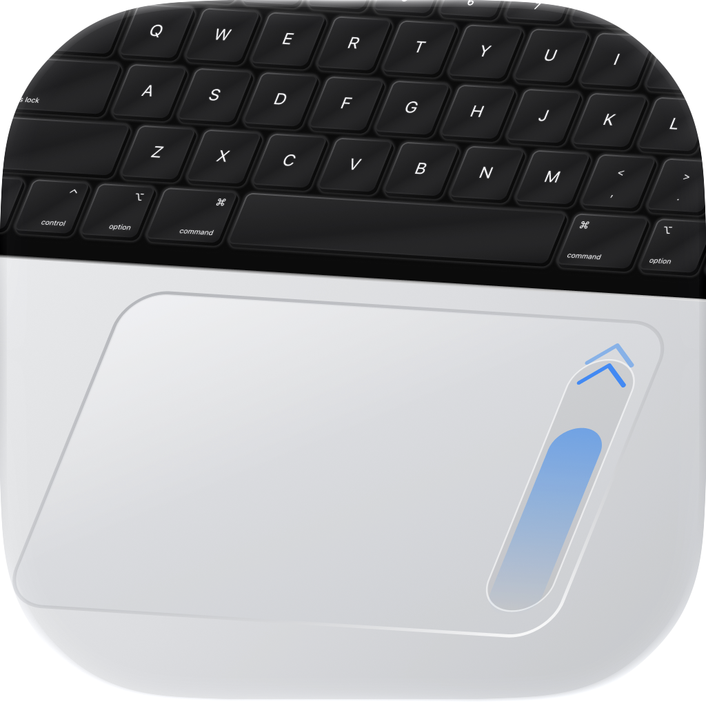
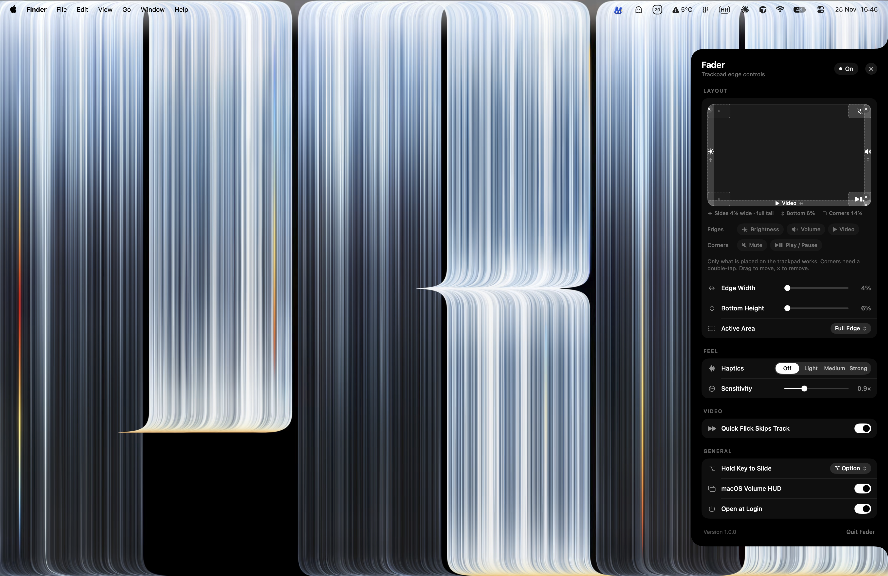

<p align="center">
  
</p>

<h1 align="center">Fader</h1>

<p align="center">Brightness, volume, and media controls on the edges of your trackpad.</p>

<p align="center">
  
</p>

Fader turns the edges of your Mac's trackpad into controls. Slide one finger along the left edge to change brightness or along the right edge to change volume. Use the bottom edge to scrub through a video or skip tracks. When your finger isn't on an edge, the trackpad works just like before.

## Features

- **Brightness on the left edge.** Slide up or down to change display brightness.
- **Volume on the right edge.** Slide up or down to change the volume.
- **Media on the bottom edge.** Slide to scrub, flick to skip a track, and tap to play or pause.
- **Corner shortcuts.** Double-tap a corner to mute, or to play and pause. Each corner can have its own action.
- **Custom layout.** Choose what each edge does, how wide the edges are, and which part of the edge responds.
- **Fine control.** Hold <kbd>⇧</kbd> <kbd>⌥</kbd> while sliding to make smaller changes.
- **Haptic feedback.** Feel each step through the trackpad, with light, medium, or strong haptics.
- **Hold a key to slide.** Optionally make edge gestures work only while you hold fn, Control, Option, or Command.
- **Its own HUD.** See levels and what's playing in Fader's HUD, or use the built-in macOS one.
- **Launch at login.** Start Fader automatically when you log in.

## Requirements

- macOS 13 or later
- A Mac with a trackpad (built-in or Magic Trackpad). Haptics need a Force Touch trackpad.

## Installation

### 1. Install with Homebrew

```sh
brew install --cask sharky-3/tap/fader
```

### 2. Allow the app to open

If macOS blocks the first launch, open **System Settings → Privacy & Security** and select **Allow Anyway** next to the Fader security notification, if available.

### 3. Launch Fader

Open Spotlight with <kbd>⌘</kbd> <kbd>Space</kbd>, search for **Fader**, and press <kbd>Return</kbd>.

Fader has no Dock icon. On first launch, a short setup walks you through the gestures and permissions. After that, open Fader again from Spotlight to show its settings, which slide in from the side of the screen. Press <kbd>Esc</kbd> or click anywhere else to close them.

## Updating

```sh
brew upgrade --cask fader
```

## Permissions

| Permission | Used for |
| --- | --- |
| Accessibility | Reading trackpad gestures and controlling brightness, volume, and media |

## Building from source

1. Clone the repository:
   ```sh
   git clone https://github.com/sharky-3/Fader.git
   cd Fader
   ```
2. Open `Fader.xcodeproj` in Xcode 26 or later.
3. Select the **Fader** scheme and press <kbd>⌘</kbd> <kbd>R</kbd>.
